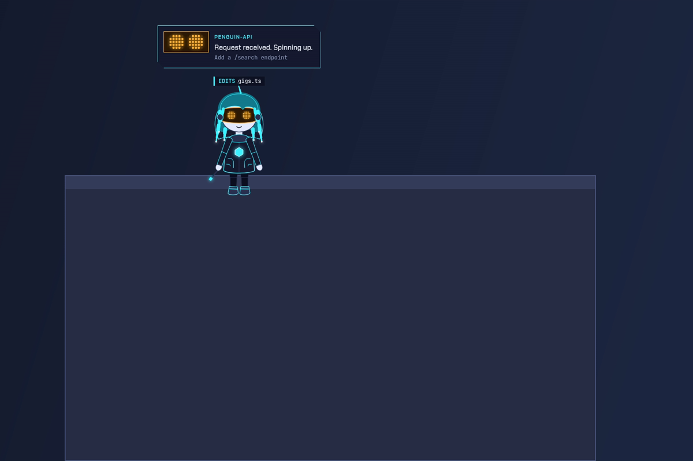
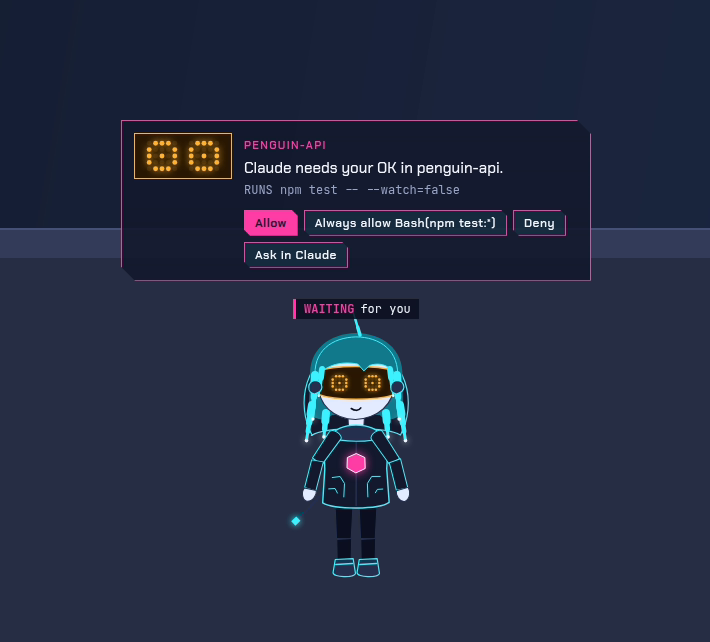
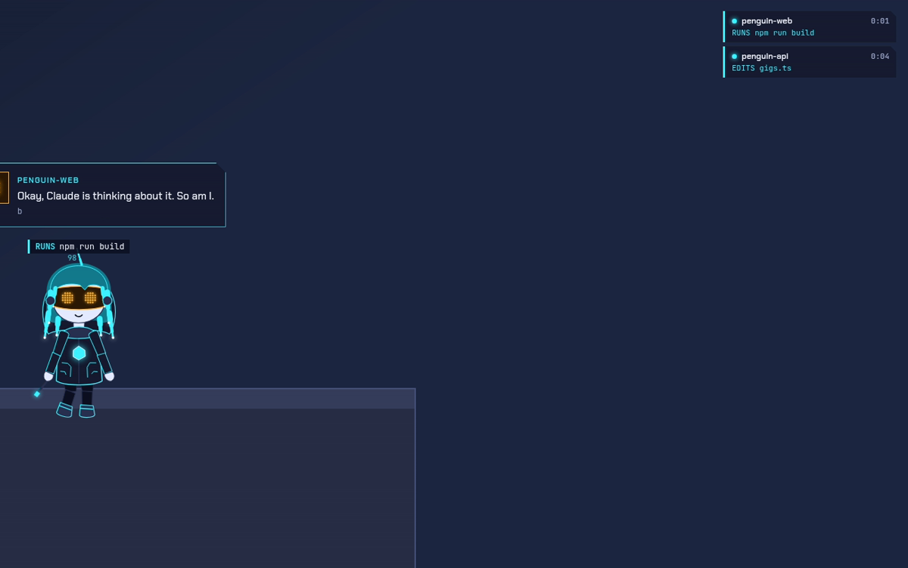
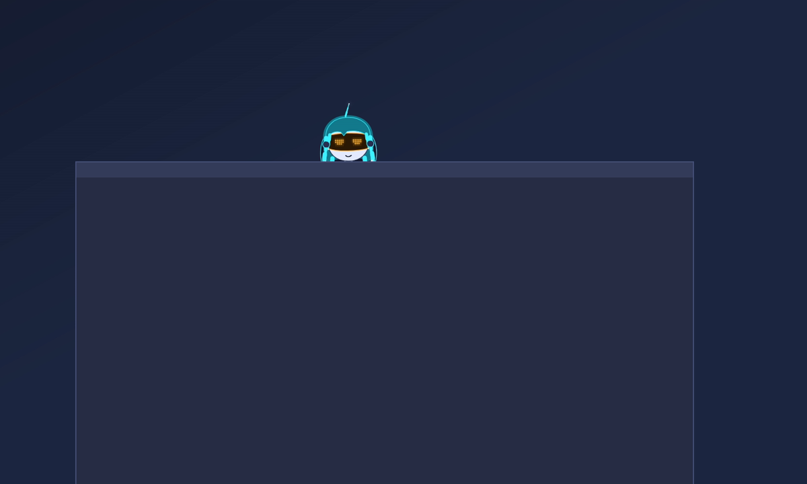
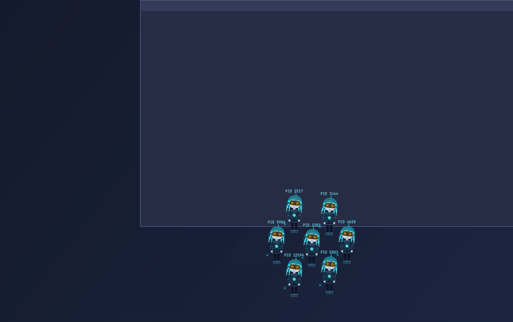
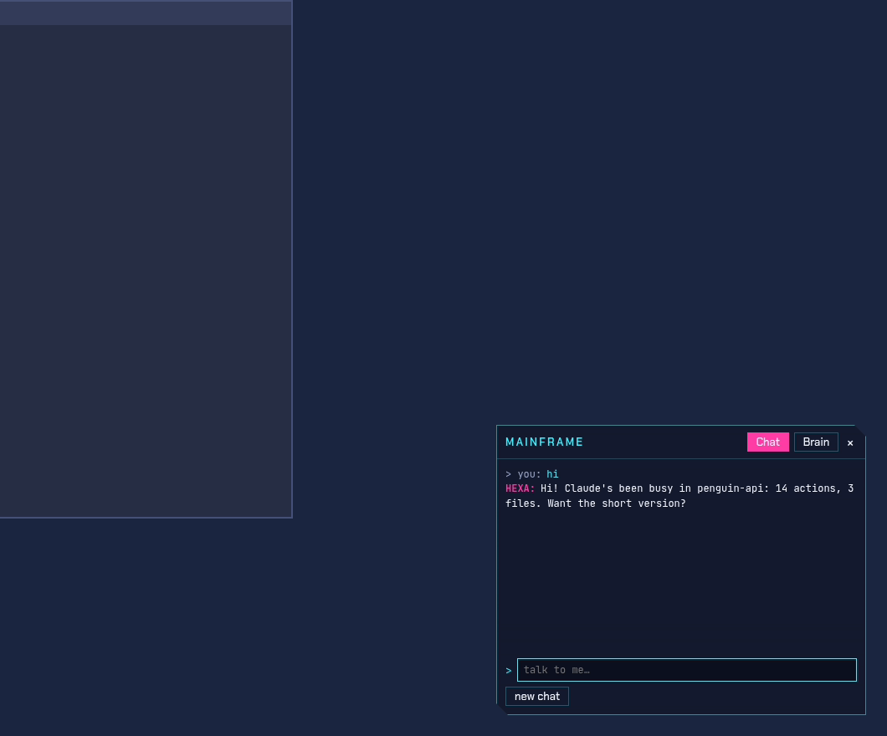
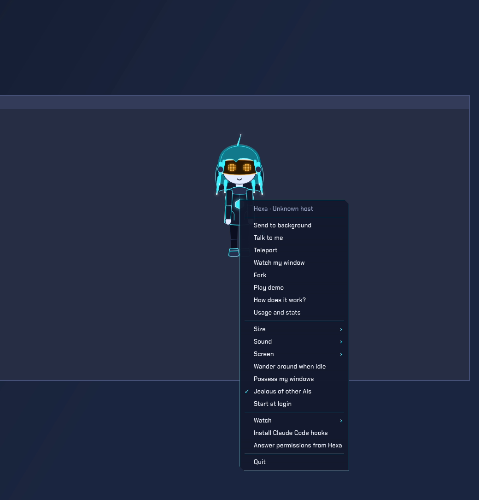

# Hexa

**A small construct who lives on your Linux desktop and watches Claude Code work for you.**

Hexa stands on your screen, sits on the window you're working in, and tells you what Claude is
doing: which file it's editing, which command it's running, when it's thinking, when it needs you,
when it broke something, and when it's done. You can talk to her, let her answer Claude's
permission prompts, and (if you allow it) have her do things on your computer.

She's a Linux-native take on [capri-desktop](https://github.com/mochiiwuff/capri-desktop), which only
runs on Windows. Hexa is built from its MIT v0.4.3 code and from there grows her own features. She's
an **original character**: she isn't Capri, and doesn't look or sound like her.



## What she does

**Watching Claude Code**
- A ticker over her head with what Claude is doing (`EDITS gigs.ts`, `RUNS npm test`). While Claude
  is quiet mid-task it counts the seconds it's been thinking.
- When Claude needs you, she comes to your pointer. If you're in another window, she goes to
  Claude's window and points at it.
- A failing command knocks her back, and she shows the line of the error that matters.
- When Claude is done: an `exit 0` victory, a summary (`12 actions · 3 files changed · 2m 14s`), and
  Claude's last sentence. If you're away from Claude's window, she brings you the whole answer.
- With two or more Claude sessions running, a **sessions HUD** lists them. Click one and she points
  at its window.

| | |
|---|---|
|  |  |

**Living on your desktop**
- She perches on the window in front of you while Claude works, rides along when it moves, and
  falls off when it closes.
- She peeks over a window from behind it, and now and then takes it over (possession).
- You can throw her. She follows you to your other screens.
- She teleports as an orb of light. She has her own right-click menu, a **Fork** (seven copies of
  her with PID tags, then she `wait()`s and reaps them), and a greeting that fits the time of day.

| | |
|---|---|
|  |  |

**Answering permissions from her** (off until you turn it on)
- When Claude Code wants permission for something, she brings you a card with **Allow**,
  **Always allow**, **Deny** and **Ask in Claude**.
- Only your own click on that card answers. If you don't answer within 10 seconds, Claude asks you
  in the terminal as usual.

**Talking to her: her Mainframe**



- **Three brains:** a small or a bigger local model through [Ollama](https://ollama.com) (free, and
  nothing leaves your machine), or Claude with your API key.
- **With Claude she can do things:**
  - open websites, apps, files and folders
  - play, pause or skip your music
  - set reminders
  - look at your screen when you ask her to
- **Computer use** (off until you turn it on): she uses your mouse and keyboard for a task you give
  her.
  - She asks first, every time, and stops before anything consequential.
  - She shows her steps on a task card.
  - **Esc** stops her at once.
- **Voice:** she can listen locally through [whisper.cpp](https://github.com/ggml-org/whisper.cpp)
  ("talk and I'll type back").

**Fitting into Linux**
- **Away from her:** when she's in the background or Do Not Disturb is on, Claude's news comes as a
  desktop notification. Do Not Disturb also keeps her quiet.
- **Music:** she nods along while it plays (MPRIS).
- **Her own state:** she feels her machine's CPU, memory, battery and heat.
- **Usage:** a stats window with tokens, estimated cost, time per project and the day's history.
- **A `hexa` CLI:** `hexa say`, `hexa react fork`, `hexa run -- make` (she shows `RUNS make`, then
  reacts to its exit code), `hexa status`, `hexa stats` and more.
- **Desktops:** KDE Plasma first, on X11 and Wayland. Her window is click-through, so she never
  takes focus, a taskbar entry or an Alt+Tab slot.



## Install

Packages for Fedora, openSUSE, Ubuntu and Debian, and Arch, plus an AppImage and a tarball, are on the
[releases page](https://github.com/GithubGiggler/hexa/releases). Step-by-step guides for each are in
**[docs/install](docs/install/README.md)**.

From source:

```bash
git clone https://github.com/GithubGiggler/hexa && cd hexa && npm ci && npm start
```

Then **plug her into Claude Code**: her menu → *Install Claude Code hooks* (or
`npm run hooks:install`), and start a new Claude Code session.

### What she needs

| | |
|---|---|
| Desktop session | X11 with a compositor (KDE Plasma, GNOME, Xfce, Cinnamon...), or Plasma on Wayland (she runs through XWayland and tracks windows through a KWin script) |
| Tray | A StatusNotifierItem tray. KDE has one; GNOME needs the AppIndicator extension |
| Claude Code | For her to watch it; she keeps you company without it |
| Optional | Ollama (local brains), an Anthropic API key (Claude brain), whisper.cpp + ffmpeg (voice) |
| Computer use | An X11 session |

## Docs

- [Using her](docs/usage.md): everything above, in detail, plus her settings
- [Privacy](docs/privacy.md): what stays on your machine (almost everything) and what doesn't
- [Her Claude Code hooks](docs/hooks.md)
- [Making a character pack](docs/character-packs.md)
- [How she's built](docs/architecture.md)
- [Translating her](docs/translating.md)

## Privacy, in short

- Claude Code's events go to her over a local socket and stay there.
- She reads Claude's transcripts only for token counts, never their text.
- Nothing is sent anywhere unless you pick her Claude brain. Then your chat goes to Anthropic, and
  screenshots go only when you ask her to look at your screen or to use your computer.
- Your API key lives in your desktop's keyring.
- There's no telemetry. The details are in [docs/privacy.md](docs/privacy.md).

## Developing

```bash
npm ci
npm test          # unit tests
npm run dev       # run her with her debug routes on
```

The live checks (`npm run live:all`) drive her for real on a **hidden desktop**: a headless KWin
inside its own user, mount, PID and network namespaces. Nothing in them can reach your screen, your
session or your X server. See [CONTRIBUTING.md](CONTRIBUTING.md).

## Credits and license

MIT, see [LICENSE](LICENSE). Hexa starts from
[capri-desktop](https://github.com/mochiiwuff/capri-desktop) v0.4.3 (MIT); see [NOTICE](NOTICE). The
character Capri belongs to her creators: Hexa is a different, original character, and this project
isn't affiliated with them, or with Anthropic.
